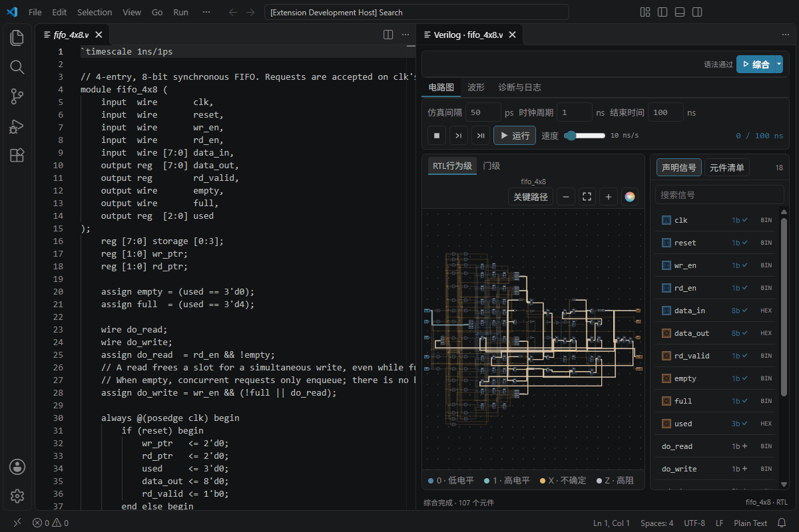

# vscode-verilog

在 VS Code 里编辑、综合和调试 Verilog/SystemVerilog。工作台提供 RTL 与门级电路图、交互式四态波形和实时诊断，界面跟随 VS Code 的当前主题。



## 安装 VS Code 扩展

**[下载 0.2.21 单文件 VSIX（Windows x64）](https://github.com/Anisluo/vscode-verilog/releases/download/v0.2.21/verilog-workbench-win32-x64-0.2.21.vsix)**

Windows x64 只需下载上面这一个文件。在桌面版 VS Code 1.96 或更新版本中，按 `Ctrl+Shift+P`，执行 **Extensions: Install from VSIX…**（从 VSIX 安装），选中该文件。Yosys、slang、ABC 和 Icarus Verilog 随扩展安装，无需配置 PATH 或工具路径。

## 打开工作台

- **试用内置示例**：在受信任的 VS Code 窗口按 `Ctrl+Shift+P`，执行 **Verilog: 打开 FIFO 示例**。左侧打开 [4×8 同步 FIFO 的纯 Verilog 源码](vscode/examples/fifo_4x8.v)，右侧打开综合工作台，点击 **Synthesis** 开始综合。
- **打开自己的设计**：在受信任的工作区打开 `.v` 或 `.sv` 文件，执行 **Verilog: 打开综合工作台**，再点击 **Synthesis**。多文件设计路径可写入 `verilogWorkbench.additionalSources`，相对路径以工作区根目录为准。综合和语法检查会读取已打开文件中的未保存内容。

综合时界面显示阶段和已用时间，并保留上一次可用的电路图。

综合工作台提供 **电路图** 和 **诊断与日志**，支持切换 RTL 与门级。波形和仿真回放位于 Testbench 工作台。语法诊断也会显示在 VS Code 的「问题」面板。

## 查看和编辑波形

切到「波形」，点击「信号 / 当前值」旁的 **＋**，搜索并勾选需要观察的信号。按住左侧信号名或当前值上下拖动，可调整波形顺序。点击信号当前值旁的格式按钮，可切换 BIN、HEX、无符号十进制或有符号十进制。32 位和 64 位信号还支持按 IEEE 754 显示为 Real，VCD 中的原生 `real` 信号默认以 Real 显示。

| 操作 | 效果 |
| --- | --- |
| 鼠标滚轮 | 以指针所在时间为中心缩放 |
| 左键横向拖选 | 放大选中的时间段，整列波形随之缩放 |
| 右键拖动 | 左右平移，保持当前缩放比例 |
| 空格 | 在波形区恢复全程显示 |
| 左键单击 | 移动仿真光标 |
| 拖动时间轴上的光标手柄 | 连续移动光标，靠近信号跳变时自动吸附 |

## FIFO 示例与自动仿真

FIFO Testbench 会自动执行复位、写入、读出和满空边界检查。波形页可观察 `used`、`empty`、`full`、`rd_valid` 和 `data_out`。

在 VS Code 中打开 `fifo_4x8.v` 或 `fifo_4x8_tb.v`，执行 **Verilog: 运行 Testbench**。扩展会识别同目录配对的 DUT 和 testbench，用 Icarus Verilog 执行行为仿真，并显示波形。切换到「电路图」可查看 DUT 方块、外部时钟与输入输出信号的连线，双击方块进入内部 RTL，点上方的 DUT 可返回。已记录的信号值随仿真光标更新。编译命令与 `PASS` 输出位于「诊断与日志」。需要使用自备版本时，可用 `verilogWorkbench.icarusPath` 指定包含 `iverilog` 和 `vvp` 的目录。

其他项目可使用 `模块名_tb.v` 或 `tb_模块名.v` 命名，`.sv` 同样适用。额外设计文件使用 `verilogWorkbench.additionalSources`，顶层模块名与文件名不同时可设置 `verilogWorkbench.testbenchTop`。Testbench 需使用 `$dumpfile` 和 `$dumpvars` 在仿真目录生成一个 VCD。

配套的 [testbench](vscode/examples/fifo_4x8_tb.v) 使用 [Icarus Verilog](https://steveicarus.github.io/iverilog/) 单独运行。在仓库根目录执行下面的命令，成功时会输出 `PASS` 并生成 `fifo_4x8_tb.vcd`。

```sh
iverilog -g2005 -s fifo_4x8_tb -o fifo_4x8_tb.vvp vscode/examples/fifo_4x8.v vscode/examples/fifo_4x8_tb.v
vvp -N fifo_4x8_tb.vvp
```

## 开发

```sh
npm ci
npm run typecheck
npm test
npm run build:vscode
```

`npm test` 需要已配置的 HDL 工具链。要在扩展开发宿主中调试，可从仓库根目录运行 `code --extensionDevelopmentPath="<仓库绝对路径>/vscode"`。

在 Windows x64 上生成带工具链的安装包时，准备带 Yosys、yosys-slang、slang 和 ABC 的 Windows 工具链，以及 Icarus Verilog Windows 分发目录。打包会保留这两个分发目录的许可证文件。运行以下命令后，在 `release/` 中取得单文件 VSIX。

```powershell
npm run package:vscode -- --hdl-root "C:/HDLTools" --icarus-root "C:/msys64/ucrt64"
```

由 [Anisluo](https://github.com/Anisluo) 开发和维护。原始实现的版权归属和许可详见 [MIT License](LICENSE)。

综合工作台的 **Target** 用来选择 ASIC（OpenSTA）或 Xilinx 7 系列 FPGA（openXC7）。扩展会记住当前工作区的选择。

## OpenSTA 静态时序分析

执行 **Verilog: 打开 FIFO 示例**，然后在综合工作台点击 **Run STA**。扩展用 Yosys 将 FIFO 映射到内置示例 Liberty，再按示例 SDC 调用 OpenSTA。**STA** 标签内显示 Setup 和 Hold 的最差 slack、路径明细与约束覆盖检查。示例使用 1 ns 时钟周期和教学用单元延迟模型，结果属于布局布线前的分析。

OpenSTA 需要单独安装。Windows 默认使用 WSL 的 `sta`（例如在 Debian 中执行 `sudo apt install opensta`），可用 `verilogWorkbench.staWslDistro` 指定发行版。也可用 `verilogWorkbench.staExecutable` 指定本机可执行文件的绝对路径。Linux 默认从 PATH 查找 `sta`。

分析自己的模块时，首次点击 **Run STA** 会提示选择缺少的 Liberty 和 SDC 文件。扩展会将选中的路径保存到当前工作区的 `verilogWorkbench.staLiberty` 和 `verilogWorkbench.staSdc`。两者可以使用绝对路径或相对于工作区的路径。SDC 应包含时钟与所需的 I/O 约束，并为自包含文件。检查报告中是否有未约束端点，再解读 slack。

## 生成 Xilinx 7 系列 FPGA 比特流

在 FPGA 目标下，点击 **Run STA** 可先运行 Yosys 和 nextpnr，查看目标器件布局布线后的时钟约束、Fmax 和关键路径。此操作只生成报告。**Build Bitstream** 会重新执行布局布线和时序检查，检查失败时停止生成 `.bit`。

在综合工作台将 **Target** 设为 **Xilinx 7 Series (openXC7)**，再点击 **Build Bitstream**，依次运行 Yosys、nextpnr-xilinx 和 openXC7 比特流工具。**Bitstream** 标签显示编译日志和 `.bit` 文件位置。

先解压 [openXC7 发布包](https://github.com/cavearr/toolchain-openxc7-releases/releases) 与该版本指定的 OSS CAD Suite。在 VS Code 设置中，将 `verilogWorkbench.fpgaToolchainPath` 和 `verilogWorkbench.fpgaYosysPath` 分别指向两个解压目录的根目录。Windows 使用 OSS CAD Suite 内的 Python。此流程使用工具包内已生成的器件数据库。

- **内置 FIFO 示例**。执行 **Verilog: 打开 FIFO 示例**，保留 FPGA 器件和 XDC 两项设置为空，然后点击 **Build Bitstream**。示例目标是 **Digilent Zybo Z7-10**（`xc7z010clg400-1`），时钟为 125 MHz。上板后 LED0 表示自检通过，LED1 表示失败，BTN0 重启自检。
- **自己的工程**。打开 FPGA 顶层源文件，设置 `verilogWorkbench.fpgaPart` 为器件、封装和速度等级的完整型号，设置 `verilogWorkbench.fpgaXdc` 为兼容的板卡 XDC。XDC 应指定板卡引脚、I/O 标准和时钟周期。可通过 `additionalSources` 添加 HDL 文件。文件生成到工作区的 `build/`，单文件工程则生成到源码旁的 `build/`。

板卡约束依据 [Digilent Zybo Z7 主 XDC](https://github.com/Digilent/digilent-xdc/blob/master/Zybo-Z7-Master.xdc)。通过 J-Link 下载时，在 **Bitstream** 页点 **Detect J-Link** 扫描 JTAG 链。编译成功后点 **Program SRAM**，扩展会确认链上恰有一个与比特流目标匹配的 FPGA，并加载到 FPGA 的易失配置存储。

JTAG 功能使用 OSS CAD Suite 中启用了 J-Link 支持的 `openFPGALoader`。探针类型默认是 `jlink`（USB ID 1366:0105），也可以在 `verilogWorkbench.fpgaJtagCable` 选 `jlink_base`（1366:0101）。Windows 上探针的 JTAG USB 接口须可由 libusb 访问。
